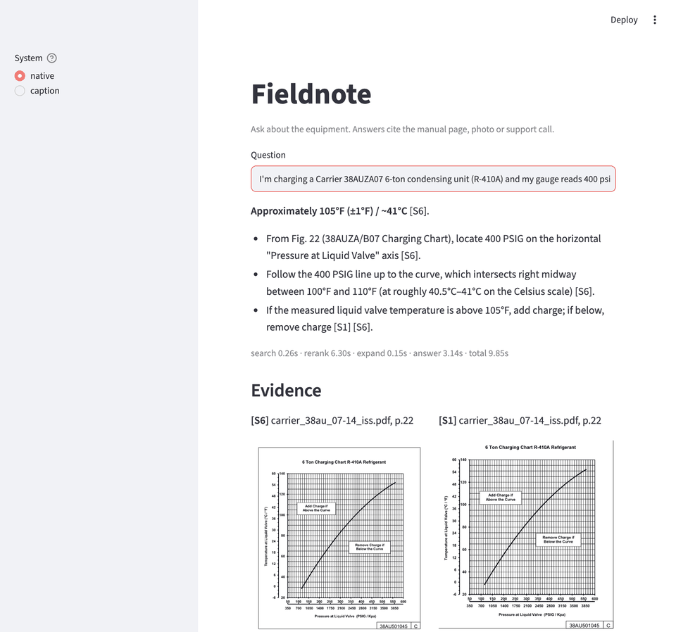

# Fieldnote

**Multimodal RAG for HVAC field technicians.** Fieldnote answers questions whose evidence exists
only inside a picture: a pressure curve on page 112 of a service manual, a wiring diagram, a photo
of a failed contactor. It also searches recorded manufacturer support calls.

> A tech on a roof asks why unit 7 keeps tripping on high pressure. The answer lives in a chart,
> not in a paragraph.

**Status:** pipeline, corpus (40 public manuals), 40-question eval, caption baseline, and
the ColQwen page-lane ablation are measured. Every number below comes from a file in
`eval/results/`.

## Results

Answer model `gemini-3.8-flash`. The published system is k=20 (text 8, image 8, audio 4),
rerank top 12, page lane off.

| Iteration | Recall@5 | Answer acc. (all 40) | Answer acc. (15 visual-only) | p95 latency |
|---|---|---|---|---|
| Parallel search + RRF | 0.50 | 0.30 | 0.13 | 5.2 s |
| + multimodal reranker | 0.80 | 0.65 | 0.33 | 9.7 s |
| + page-figure expansion | 0.80 | 0.75 | 0.53 | 6.2 s |
| Same config, rerun 2026-09-25 | 0.80 | 0.70 | 0.47 | 6.6 s |
| + ColQwen page lane (ablation) | 0.88 | 0.70 | 0.47 | 8.1 s |

Latency is the 95th percentile of 120 end-to-end asks (40 questions × 3 passes) for the
published rows, and of the single quality pass for the page-lane ablation. Rerank images
at 384 px dropped p50 from 5.1 s to 3.8 s and left p95 at 6.6 s, while visual accuracy
fell to 0.40, so 640 px stays the default. The tail is the answer call, not search.

### Head to head: caption-only baseline vs Fieldnote

Same corpus, questions, reranker (scoring caption text in baseline mode), page expansion and
answer model. The baseline captions every figure with `gemini-3.8-flash` (told to transcribe
labels and read curve values) and never sends pixels anywhere.

Paired comparison, both systems on the expansion config
(`20260924-221045_native-jina-expand.json` and `20260924-231557_caption-jina-expand.json`):

| System | Visual-only acc. (15) | Charts (8) | Diagrams / image tables (7) | All 40 | p95 latency |
|---|---|---|---|---|---|
| Caption-only baseline | 0.47 | 0.50 | **0.43** | 0.38 | **3.5 s** |
| Fieldnote | **0.53** | **0.75** | 0.29 | **0.75** | 6.2 s |

A later Fieldnote-only rerun of the same k=20 config scored 0.47 on the visual questions
(`20260925-203047_native-k20.json`). One question. The margin does not hold still.

**When late fusion is worth it.** Use it when the value lives on a curve and the gold page
is already in the top 5. On that paired run, every chart that reached the vision model was
read correctly (8/8), and captions misread values they had transcribed (a charging chart
read as 116 °F instead of 106 °F). Pay the extra latency for those questions.

**When a caption index is enough.** Text-dense schematics and image-only tables. Captions
beat SigLIP there (diagram accuracy 0.43 vs 0.29) because they transcribe the words inside
the drawing. The ColQwen page lane closes some of that retrieval gap (visual recall@5 0.53
to 0.73) and does not raise answer accuracy: other charts get misread, and p95 moves to
8.1 s. It stays off unless `FIELDNOTE_PAGE_LANE=1`.

The all-40 gap in the paired table is mostly captions crowding support-call segments out of
the top 5, not proof that pixels are better at prose. Five visual questions that still fail,
and why, are in [docs/error_analysis.md](docs/error_analysis.md).

## The trap this project avoids

The easy version of "multimodal RAG" captions every image with a vision model, embeds the captions,
and runs a text pipeline. That is a text pipeline wearing a costume. Turning a chart into a caption
throws away the axis values the question needed.

Fieldnote keeps each modality in its own embedding space and lets the answer model read the actual
pixels. The caption-only pipeline is built too, as the baseline, with a captioner told to transcribe
every value it can see. That makes it a strong baseline, not a straw man.



## How it works

```
 manual PDFs ─► PyMuPDF: text blocks ─────────────────► BGE text encoder ──┐
            └─► figure/table crops + page renders ────► SigLIP image enc. ─┤
 photos ──────────────────────────────────────────────► SigLIP image enc. ─┼─► Qdrant
 call audio ──► faster-whisper, 30s windows w/ timestamps ► BGE text enc. ─┘   (named vectors
                                                                                + modality tag)
 question ─┬─► text lane  (text vector,  modality=text)  ┐
           ├─► image lane (image vector, modality=image) ├─ parallel ─► RRF ─► multimodal
           └─► audio lane (text vector,  modality=audio) ┘                     rerank (top 20→5)
                                                                                    │
                  vision model reads crops + passages, cites [S1]..[S5] ◄──────────┘
                                                                                    │
            answer + citations: doc, page, cropped chart image | call @ mm:ss ◄─────┘
```

- **Late fusion.** Each modality is searched on its own; lists are merged by rank (RRF) because
  cosine scores from different encoders aren't comparable, then reranked on one scale.
- **Multimodal reranker.** A text cross-encoder can't score a chart, so the reranker is
  `jina-reranker-m0`, which scores query–text and query–image pairs with one model. RRF order is
  the fallback and the "rerank off" ablation.
- **Figure-level chunks.** Charts, diagrams and tables are detected per page (raster images,
  clusters of vector strokes, table detection) and cropped with a margin that keeps axis labels.
  The citation crop comes free, and retrieval is more precise than whole pages.
- **Citations you can check.** Manual answers come back with page number and a cropped image;
  call answers come back with a timestamp.

| Piece | Choice |
|---|---|
| PDF parsing | PyMuPDF |
| Text encoder | `BAAI/bge-base-en-v1.5` |
| Image encoder | `google/siglip-so400m-patch14-384` |
| Speech | faster-whisper |
| Vector store | Qdrant (local mode, or server via `docker compose`) |
| Reranker | `jinaai/jina-reranker-m0` |
| Answer model | `gemini-3.8-flash` (current runs) or Claude `claude-opus-5`, vision input, switchable via `FIELDNOTE_LLM_PROVIDER` |

All model choices are environment variables; see `fieldnote/config.py`.

## Run it

```bash
make install-ml            # uv sync with torch, transformers, faster-whisper, streamlit
export ANTHROPIC_API_KEY=...
make fetch                 # download manuals listed in data/manifest.yaml
make calls                 # render support-call scripts to audio (macOS say)
make ingest                # manuals, photos, calls -> artifacts/chunks.jsonl
make index                 # native multimodal index
make index-pages           # optional ColQwen page lane (then FIELDNOTE_PAGE_LANE=1)
make caption               # caption-only baseline index
make eval-native eval-caption compare
make demo                  # Streamlit UI
```

Ask one question from the CLI:

```bash
uv run --extra ml fieldnote ask "What discharge pressure should the unit show at 95F outdoor?"
```

## Tests

```bash
make test
```

The suite builds a synthetic service manual (prose, a vector pressure chart, a raster photo) and
runs ingestion, indexing, retrieval, citation mapping, the caption baseline and the eval runner end
to end. It uses hashing encoders and a scripted LLM, so CI needs no model downloads and no API key.

## Corpus

The corpus is a scaled-down version of the real use case, built from public data: manufacturer
service manuals (not committed, fetched by URL and checksum), CC-licensed and self-shot job-site
photos (licenses in `data/photos/LICENSES.csv`), and scripted support calls recorded for this
project. See [docs/PLAN.md](docs/PLAN.md) for the build plan and [eval/README.md](eval/README.md)
for the eval design.

## License

MIT for the code. Manuals belong to their manufacturers. `jina-reranker-m0` is CC-BY-NC-4.0,
which is fine for a portfolio project; swap it out for commercial use.
